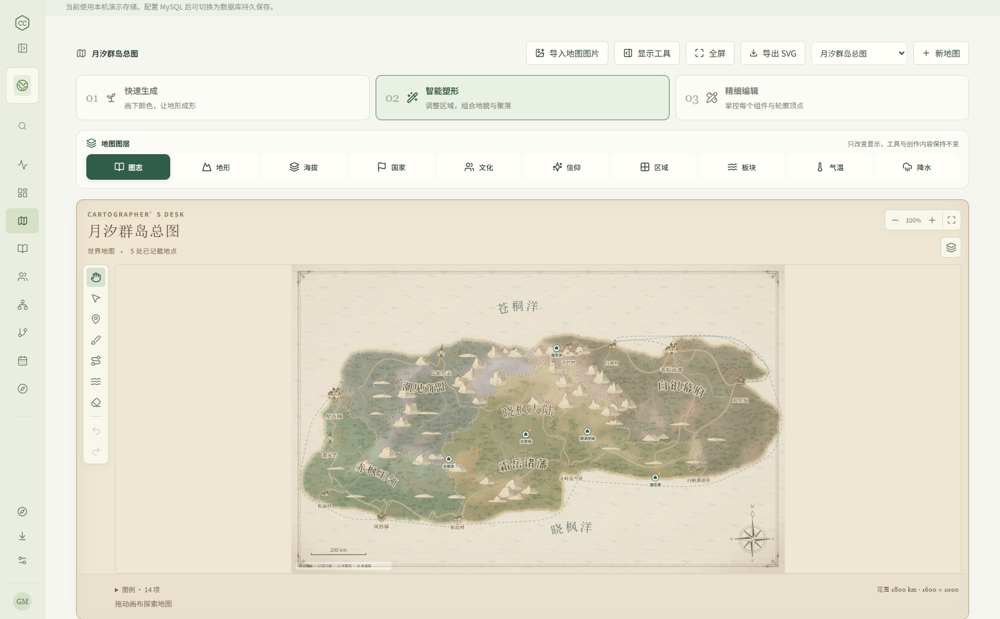
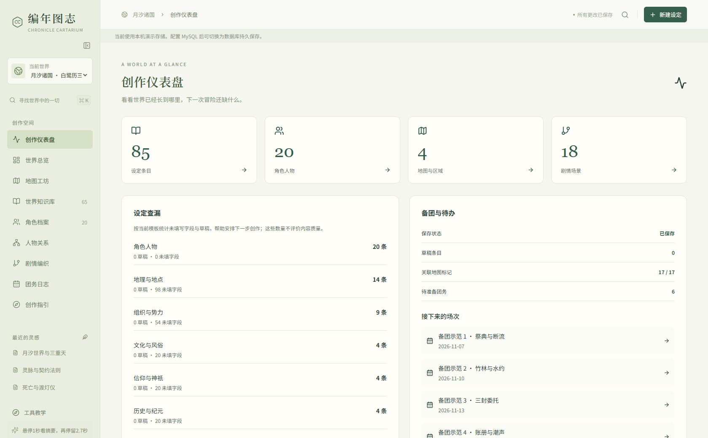

# 编年图志 · Chronicle Cartarium

**为 TRPG 主持人与世界构建者准备的地图、设定、人物关系与剧情工作台。**

通过浏览器使用，部署在自己的电脑或服务器。首次安装明确选择 **本地 SQLite** 或 **MySQL**，本地模式无需另装数据库。中文界面，目前为 **0.2.0-beta.20 公开测试版**。

[下载发行版](https://github.com/hachimenHato/chronicle-cartarium/releases) · [安装与部署](docs/installation.md) · **[各平台更新教程](docs/update-guide.md)** · [腾讯云 COS 更新镜像](docs/tencent-cos.md) · [更新与数据保护](docs/update-strategy.md) · [问题反馈](https://github.com/hachimenHato/chronicle-cartarium/issues)


## 可以做什么

- **地图工坊**：世界、区域、城镇三种尺度；随机或色块生成，图片识别色块、种子与经纬范围。地形、海拔、板块、气温、降水共同参与生成，提供三级编辑、地形纹理、聚落、港口、道路和航路。
- **疆域与推演**：按小区域划分国家、文化和信仰并关联设定；边界、前线、防御线、进攻箭头与地名可编辑，聚落和交通线可单独隐藏。
- **世界知识库**：可自定义的设定类型与字段模板、Markdown、封面、标签、搜索、关联跳转与延时锁定的多层悬浮词条。
- **人物与剧情**：角色立绘、展开式人物关系图、剧情路线、条件和变量、GM 计划与团务记录。条件以受限规则计算，不执行任意代码。
- **创作辅助**：仪表盘、创作指引、首次工具教学、主题、可收起侧栏和地图全屏。
- **自主管理**：登录、可选多用户、模块与逐条权限、GM 私密内容控制、Markdown/JSON/SVG 导出、完整备份与受签名程序更新。

安装时可选原创日式中世纪剑与魔法范例：85 条世界设定、20 位人物、4 张地图、30 条关系、18 个剧情场景及 GM 计划等。默认不填充。

## beta.20 更新

“工作台设置 → 程序更新 → 更新来源与渠道”新增内置的 **国内下载源（腾讯云）**，选择并保存即可，无需填写地址、注册腾讯云或提供密钥。GitHub 仍为默认来源，原有自建 HTTPS 镜像及离线导入保留；Windows 桌面窗口更新沿用同一来源偏好。

国内源同步官方已签名文件，所有文件匿名回读校验通过后才发布更新清单。**内置选项不代表每个新版本已同步完成**：以[同步任务](https://github.com/hachimenHato/chronicle-cartarium/actions/workflows/cos-mirror.yml)最终成功及实际下载验证为准，源不可用或下载失败时尝试 GitHub。原官方验签、完整备份与恢复验证照常执行，资料和数据路径保持；不是无人值守安装。

**beta.19 可直接在线升级到 beta.20**，获得内置国内源选项；原 EXE 的自动更新最低版本仍为 beta.19。后端选好内置国内源后，原 beta.19 壳也能直接沿用设置在线升级，无需先切换来源或手填地址。beta.18 及之前需先完成一次离线过渡，旧 EXE 另需手动换壳，见 **[各平台更新教程](docs/update-guide.md)**。本次同时完善 COS 发布器的空桶检查、安全进度提示、并行与长时等待；普通上传默认不启用收费全球加速。地图高倍率浏览优化继续保留，详见[性能说明](docs/map-performance.md)。

## 界面预览

以下为软件真实界面，使用自带的虚构“月汐诸国”范例，不含个人创作或账号资料。

**地图工坊**：羊皮纸地图、地形细节、聚落与交通，以及可切换的地理图层。



**创作仪表盘**：查看设定、人物、地图和剧情数量，安排创作与备团任务。



## 版本与平台支持

当前提供公开测试版，尚未宣称达到正式生产版的稳定性。桌面版和 CMD/服务器版使用相同的创作格式；桌面版是独立附加下载，原 CMD 版继续保留。

| 下载形式           | 支持平台 / CPU                    | 使用方式                                                            | 验证范围                                                                        |
| ------------------ | --------------------------------- | ------------------------------------------------------------------- | ------------------------------------------------------------------------------- |
| Windows 桌面窗口版 | Windows x64                       | 完整解压，双击 `Chronicle Cartarium.exe`；内置运行组件，无需浏览器  | Windows 实机验证安装、地图、导出和重启保留数据；未做商业代码签名，无安装/卸载器 |
| Windows CMD 版     | Windows x64                       | `start.cmd` 后通过浏览器访问；适合本机或服务器                      | Windows 原生 CI 与本机启动/保存/重开验证                                        |
| Linux 版           | Linux x64、arm64                  | `sh start.sh` 后通过浏览器访问                                      | x64 原生 CI；arm64 完成打包校验，未做原生完整验收                               |
| macOS 版           | Intel x64、Apple Silicon arm64    | `start.command` 或 `sh start.sh` 后浏览器访问                       | arm64 原生 CI；Intel 包完成打包校验，未做原生完整验收；无独立桌面窗口版         |
| Docker             | Linux amd64、arm64 镜像           | Compose 部署，浏览器访问；Windows/macOS 需 Docker 的 Linux 容器环境 | amd64 安装/持久卷重启/登录 CI；arm64 镜像构建，未做原生完整验收                 |
| 源码               | Node.js 22.18+，SQLite 或 MySQL 8 | 自行构建与部署；桌面构建目前仅 Windows x64                          | Windows / Linux / macOS 类型检查、单元测试与构建 CI                             |

具体版本的附件、功能和实测范围以 [对应 Release](https://github.com/hachimenHato/chronicle-cartarium/releases) 为准。`main` 可能包含尚未进入下载包的功能；旧版附件不会因源码更新而自动改变。所有平台的完整升级、断电恢复与公网场景均未全面验收。

## 快速开始

### 下载使用

Windows 另提供独立窗口的**桌面版 ZIP**：完整解压后双击 `Chronicle Cartarium.exe`，无需 CMD、系统浏览器或首次联网安装依赖。原 CMD 版继续保留；桌面版数据与已有工作台使用方式见 [桌面版说明](docs/desktop.md)。

在 [Releases](https://github.com/hachimenHato/chronicle-cartarium/releases) 选择匹配系统和 CPU 的包，解压到**可写的新目录**。Windows 双击 `start.cmd`；Linux 执行 `sh start.sh`；macOS 双击 `start.command` 或执行 `sh start.sh`。

**首次下载与在线更新的覆盖范围不同。** 国内源同步五平台的 `.ccupdate` 以及 Windows 桌面完整 ZIP 和签名描述；Windows 桌面 ZIP 完成同步后可用于国内首次下载。其他 CMD / Linux / macOS 完整安装包目前仍从 GitHub 下载，Docker 镜像和 npm 依赖也不经此源。国内入口、文件路径及同步确认见[首次下载说明](docs/update-guide.md#首次下载安装与国内源覆盖范围)；未同步完成的链接不能使用。

访问 **http://localhost:3001/**，按向导选择数据库、访问方式和主题。登录默认开启，需要自行设置主管理员登录名和密码；也可选择免登录，不要求账号密码，此时无法开启多用户。安装时可直接开启多用户，以后也可在后台调整；多用户开启期间不能关闭登录。没有通用默认密码。CMD/Linux/macOS 包首次启动准备 npm 依赖需要联网；带运行时的包无需另装 Node.js。不要混用各系统的运行时或 `node_modules`。

### 从源码运行

需要 Node.js **22.18+** 和 npm，推荐 Node.js 22 LTS 最新维护版。

```sh
npm ci
npm run build
node scripts/launch.mjs
```

开发时执行 `npm run dev`，前端在 5173 端口。源码也可使用启动文件。安装向导通常无需 `.env`，高级配置参考 [.env.example](.env.example)。

### Docker 与服务器

在私有 `.env` 设置至少 24 字符的随机 `CHRONICLE_CARTARIUM_SETUP_TOKEN` 后，可直接使用已发布的 Linux amd64/arm64 镜像：

```sh
docker compose -f docker-compose.image.yml up -d
```

也可执行 `docker compose up -d --build` 从源码构建。在向导中输入授权码，选择 SQLite 或自己的 MySQL。Compose 使用持久数据卷，不捆绑 MySQL 服务。公网部署应使用 HTTPS、`COOKIE_SECURE=true`，仅在可信代理后设置 `TRUST_PROXY=true`。详见 [安装说明](docs/installation.md)。不要删除数据卷来升级。

## 数据保护与更新

新安装数据默认在 `data/`；受管理启动器将实际绝对数据路径固定在 `.worldloom/current.json`。数据库、图片、安装配置与账号权限均需保留。MySQL 安装只创建确认不存在的**新项目专用库**，不复用或清空其他库。

后台完整 `.ccbackup` 包含账号密码哈希与数据库凭据，**目前不加密，请私密保存**。JSON/Markdown 不包含上传原图，不能代替完整备份。

已有实例使用后台受签名 `.ccupdate`：校验、排空写入、完整备份并验证后切换，同系统、同架构、兼容数据格式才允许更新。beta.19 起支持“检查更新 → 下载并安全更新”；旧版先离线升级一次，之后有兼容新版时使用在线入口。离线导入继续保留，普通 ZIP/TAR 不能当作更新包。

| 使用方式               | 更新入口                                                                                           |
| ---------------------- | -------------------------------------------------------------------------------------------------- |
| Windows 桌面后端 / CMD | 后端使用 Windows x64 `.ccupdate`；桌面窗口从“帮助 → 检查桌面程序更新…”自动更新；旧壳先手动过渡一次 |
| Linux / macOS          | 选择相同系统、架构的签名 `.ccupdate`；完整升级恢复验收范围以本版 Release 为准                      |
| 源码 / 长期服务器      | 固定安装根的 `scripts/launch.mjs` 启动后使用签名更新；手动迁移须保留或恢复原资料                   |
| Docker                 | 宿主机保留原项目、卷和配置后更换镜像；不能用网页 `.ccupdate` 替换容器                              |

逐步操作见 **[各平台更新教程](docs/update-guide.md)**，保护机制和实测边界见[更新说明](docs/update-strategy.md)。已有数据却出现安装向导时先检查路径，**不要重新初始化**。

维护者可按[腾讯云 COS 镜像教程](docs/tencent-cos.md)配置专用桶、域名和 GitHub Secrets，使公开 Release 发布后自动同步签名更新包。工具只上传白名单，版本文件禁止覆盖，清单最后发布；应用和下载包不包含腾讯云密钥。用户选择内置“国内下载源（腾讯云）”即可，实际版本可用性仍以同步完成和公开下载验证为准。

## 当前边界

- 地理气候是创作近似模型，不是科学预测或 GIS 测量结果；见 [气候模型](docs/climate-model.md) 和 [生成说明](docs/geographic-generation.md)。
- 单 Node.js 实例、完整工作区快照与 revision 冲突检查；尚无实时协作或多实例部署。超大地图仍有保存与矢量绘制成本。
- 登录会话在内存中，重启后需重新登录。首次启动和更新准备依赖需要联网。
- Windows 本机通过功能验证；Linux、macOS、Docker 的原生测试状态以具体发行说明为准，打包成功不等于完整生产或断电恢复验收。

## 开发

React 19 + TypeScript + Vite、Node.js + Express、SQLite / MySQL。领域契约在 `shared/`，服务端在 `server/`，界面在 `src/`。

```sh
npm run typecheck
npm test
npm run build
# 地图/悬浮改动另运行；只使用 3311 临时演示存储
npm run test:ui
```

真实 MySQL 测试以 `npm run test:mysql` 显式启用，只操作测试自身创建的新临时库。

[架构](docs/architecture.md) · [范例地图](docs/example-maps.md) · [素材来源](docs/cover-presets.md) · [安全说明](SECURITY.md) · [接手入口](docs/handoff.md)

## AI 制作说明与免责声明

本项目主要通过 AI（ChatGPT / Codex）协助设计、编写与迭代，包含部分 AI 生成的范例文字和封面插画。已执行自动化测试与部分实机验证，但代码、文档、地图和设定仍可能存在错误、遗漏或不符合预期的结果；不能将 AI 生成内容视为经过专业审核的科学、法律或其他专业意见。

软件按下述 0BSD 许可“按原样”提供，不作适用性或无错误保证。公开测试版请先试用，并在升级、迁移或重要操作前验证完整备份；发现问题可提交 [Issue](https://github.com/hachimenHato/chronicle-cartarium/issues)。上游组件保留其各自许可，AI 辅助制作不改变这些许可要求。

## 许可

原创代码采用 [0BSD](LICENSE)：允许商用、修改、分发和闭源使用，无强制署名或公开衍生源码要求。[0BSD 是 OSI 批准的零条款许可](https://opensource.org/license/0bsd)。

第三方组件保持各自许可，见 [完整依赖许可](DEPENDENCY_LICENSES.md) 和 [补充声明](THIRD_PARTY_NOTICES.md)。随包 Node.js/npm 的声明位于 `runtime/`。四张封面为本项目生成插画，不主张独占权；不包含用户上传或商业 TRPG 规则文本。项目名称与标志不代表对衍生产品的背书。
